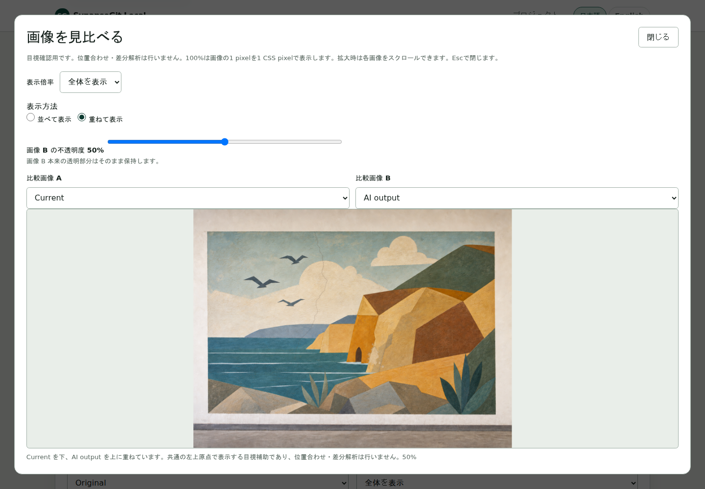

# SynapseGit

[English](./README.md) | [日本語](./README.ja.md)

[](https://github.com/howlrs/synapsegit/actions/workflows/ci.yml)
[](https://github.com/howlrs/synapsegit/releases/tag/v1.5.0)


[](./LICENSE)

**AIで試した案を、選んだ理由ごと残せます。** SynapseGitは、見比べた画像とあなたの判断を手元に保存する制作記録ツールです。いつもの画像生成ツールで作った案を使えます。準備はAIエージェントに頼み、あなたはブラウザで画像を見て、採用・不採用・保留を選びます。

たとえば、夕景のイラストで空の色を変える場面なら、次の3枚が一組です。

| 元の画像（Original） | 現在の画像（Current） | AIの候補（AI output） |
|---|---|---|
| 色の基準にした最初のラフ | 今の作業版の書き出し | AIで空を赤くした案 |

[](./docs/assets/creator-colour-review.png)

**最初に目に入るのは、自転車の人ですか、それとも空ですか？** 左が作業版、右が候補という想定のイラストです。夕焼けの印象を強めたいなら右を採用できます。人物を主役にしたいなら、「上着が空に溶けるので、背景の赤を弱めたい」と理由を残せます。

自分の制作に合うかは、まず1案で試せます。次の修正を始めるとき、エージェントに「前の案ではどこが気になった？」と尋ねてください。見比べた画像と自分の言葉が、次にAIへ何を頼むかを決める手がかりになります。

## 始める

### 1. 同梱の3枚でAIに準備を頼む

手元のファイルを読んでターミナルでコマンドを実行できるAIエージェントを使います。まず対応環境の手順に沿って配布ファイルを検証し、`synapse`をインストールします。配布版の利用にはRustは不要です。[Linux x86_64（glibc 2.34以降）](./docs/install.md#install-the-linux-x86-64-release) ／ [Apple Silicon搭載Mac](./docs/install.md#install-the-macos-arm64-release)

インストールもエージェントに任せるなら、上の手順を渡し、「この環境用のv1.5.0を手順どおり検証してインストールし、サンプルの入ったフォルダを教えて」と頼めます。

展開した配布フォルダをエージェントで開き、次の依頼文を貼り付けてください。教材は架空の壁画の画像です。

> このフォルダの `AI_AGENT_GUIDE.ja.md` を読んで、SynapseGitで壁画の案を1件試せるようにして。
> `docs/tutorial/assets/` の `mural-original.png` を元の画像、`mural-current.png` を現在の画像、`mural-ai-proposal.png` を候補に使って。
> 対象名は「壁画の練習」、作成者名は「体験用」で、練習用のプロジェクトとInboxを準備して。
> 候補をInboxに置いたら、私がブラウザで比較できるローカルURLを教えて。判断と理由は私が入力するので、そこで待って。

リポジトリをクローンした場合は、ルートで同じ依頼文を使い、ガイド名だけを `docs/ai_agent_guide.ja.md` に変更します。自分の作品で試すときは、3つのファイルのパス、対象名、作成者名を差し替えてください。

### 2. 画像を見比べ、選んだ理由を残す

1. エージェントが返した `http://127.0.0.1:…` を同じコンピューターで開きます。プロジェクトの「取り込む」で「取り込み待ち」の「確認する」を押し、「取り込み内容を確認」に並ぶ3枚を確かめて、その欄の「提案を作成」を選びます。
2. 現在の画像と候補を並べて確認します。縦横のサイズが同じ画像は重ねて比較できます。理由を書き残したいときはここで入力し、採用・不採用・保留から自分の判断を選んで確定します。
3. 記録後、エージェントに「今の壁画の記録を開いて、私が選んだ判断と、書き残した理由を教えて」と頼んでみてください。次の案を試すときも、この判断は元の記録に残ります。

[](./docs/assets/synapse-local/image-comparison.png)

*チュートリアルの合成画像を使った実際の比較画面（v1.0.0-rc.1撮影）。表示言語は日本語・英語を選べます。*

### コマンドで起動する

自分で操作する場合は、次の2行でプロジェクトを用意し、ブラウザで取り込みを始められます。

```bash
synapse init "$HOME/SynapseGit/demo"
synapse serve --project "demo=$HOME/SynapseGit/demo"
```

表示されたURLを開き、プロジェクトの「取り込む」で3枚を選びます。コマンドだけで判断とレポートの確認まで進める手順もあります。[15分 壁画チュートリアル](./docs/tutorial/README.ja.md)

## 実際の作品ではどう使う？

[「星月夜の上塗り」](./docs/examples/starry-night/README.ja.md)では、開発者がレプリカにアクリル絵の具を重ねる過程を記録しました。明るい青を塗る工程では、最初の写真、白を塗り終えた写真、AIが提案した「次に青を置く場所」の地図を見比べています。公開された5件の採用記録から、各工程で選んだ提案をたどれます。[記録をまとめた公開用ファイル](https://github.com/howlrs/synapsegit-starry-night/tree/45db60e3497f5392a9fb93135698021d23e42059/synapsegit/bundle)

## 次にしたいこと

| やりたいこと | 読む資料 |
|---|---|
| エージェントに候補の準備や記録の読み返しを頼む | [AIエージェント向けガイド](./docs/ai_agent_guide.ja.md) |
| 生成時のプロンプトを控える、気になる箇所にピンを付ける、同じ参照画像で別案を試す | [クリエイター向け操作ガイド](./docs/creator_workflow.md) |
| 作品の経緯を人に見せるために、公開用の文章と閲覧用ファイルを用意する | [公開用の制作ノート](./docs/presentation_sidecar.md) |
| 記録をバックアップ・復元する | [ローカルアプリの運用手順](./deploy/local/README.md) ／ [CLIリファレンス](./docs/cli_reference.md) |
| 技術仕様やライブラリの機能を調べる | [Core Protocol](./spec/core/v0.1/README.md) ／ [実装の範囲](./docs/implementation_boundaries.md) ／ [資料一覧](./docs/README.md) |

## 記録の範囲と利用条件

- SynapseGitは1人で使うローカルアプリです。画像生成は普段のツールで行います。SynapseGitの画面は `127.0.0.1` だけで開きます。
- 見た目は自分の目で比較します。自動検証の対象はファイルの内容と記録の整合性です。作者、権利、モデルの実行、現物がどう変わったかは、この記録からは証明できません。
- 理由やプロンプトは非公開の制作記録で、通常のバックアップにも含まれます。公開用のファイルには元画像や非公開メモは入りません。[データの扱い](./docs/security_model.md)
- v1.5.0の配布版はLinux x86_64とmacOS arm64に対応します。Linux ARM64はソースからのビルドが必要です。Windowsはサポート対象外です。[インストール手順](./docs/install.md)
- 自分の環境で非商用評価として試せます。商用・本番・ホスティング利用には別途書面での許可が必要です。[ライセンス](./LICENSE)

## リリースと互換性

v1.5.0の配布ファイルには、SHA-256チェックサムとビルド元を確認するための証明が付いています。v1.xでは記録の形式を維持しており、過去のリリースで作った記録とバックアップを読み込めます。[v1.5.0の配布ファイルと検証情報](https://github.com/howlrs/synapsegit/releases/tag/v1.5.0) ／ [変更履歴](./CHANGELOG.md) ／ [互換性方針](./docs/compatibility.md)

## サポートとライセンス

使い方の質問や不具合はサポート窓口で受け付けています。脆弱性の疑いはGitHubの非公開報告窓口にお寄せください。[サポート](./SUPPORT.md) ／ [脆弱性の報告](./SECURITY.md) ／ [開発への参加](./CONTRIBUTING.md)

Copyright (c) 2026 howlrs and K-Terashima. 独自のSynapseGit Source-Available License 1.0を適用します。GitHubでのフォーク、フォーク内での改変、プルリクエスト、管理下の環境での非商用評価が可能です。許可されたフォークの範囲外での再配布には別途書面での許可が必要です。条件の正本は英語版です。[ライセンス全文](./LICENSE) ／ [日本語の概要](./docs/license_ja.md) ／ [第三者ライセンス](./THIRD_PARTY_NOTICES.md)
