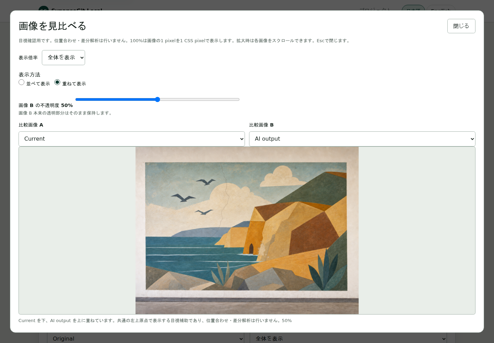

# SynapseGit

[English](./README.md) | [日本語](./README.ja.md)

[](https://github.com/howlrs/synapsegit/actions/workflows/ci.yml)
[](https://github.com/howlrs/synapsegit/releases/tag/v1.5.0)


[](./LICENSE)

**Keep the image you tried and the reason you chose it.** SynapseGit gives you a local history of the alternatives you considered while making an image. Make a candidate in your usual AI image tool, ask an agent to set up the comparison, then choose Adopt, Reject, or Defer in your browser.

Suppose you're trying a different sky in an illustration. One review uses three images:

| Original | Current | AI output |
|---|---|---|
| The first colour study you want to keep as a reference | An export of the illustration as it stands | An AI variation with a redder sky |

[](./docs/assets/creator-colour-review.png)

**What catches your eye first, the rider or the sky?** Imagine the print on the left is your working image and the one on the right is the candidate. If the sunset is your subject, you might adopt the warmer version. If the rider is your subject, you might write, “The jacket blends into the sky. Try less red behind the rider.”

To see whether this fits your practice, try it on one variation. When you return for the next edit, ask your agent, “What bothered me about the last version?” The images and your own words can help you decide what to ask the AI to try next.

## Get started

### 1. Ask your agent to prepare the sample

Use an AI agent that can read files and run terminal commands on your computer. Follow the instructions for your platform to verify the release archive and install `synapse`. The prebuilt release runs without Rust. [Linux x86_64 (glibc 2.34+)](./docs/install.md#install-the-linux-x86-64-release) · [Mac with Apple Silicon](./docs/install.md#install-the-macos-arm64-release)

For help with installation, give the agent the instructions for your platform and ask, “Verify and install v1.5.0 for this computer using these instructions, then show me the folder containing the samples.”

Open the extracted release folder in your agent and paste this request. The sample uses three images of a fictional mural.

> Read `AI_AGENT_GUIDE.md` in this folder and help me review one mural proposal in SynapseGit.
> In `docs/tutorial/assets/`, use `mural-original.png` as Original, `mural-current.png` as Current, and `mural-ai-proposal.png` as the candidate.
> Set up a practice project and an Inbox. Use “Mural study” for the subject and “Demo creator” for the creator name.
> Put the candidate in the Inbox and give me the local URL where I can compare the images. Wait there so I can enter my own decision and reason.

Using a source checkout? Open the repository root and change the guide name in the request to `docs/ai_agent_guide.md`. To try your own images, replace the three file paths, the subject and the creator name.

### 2. Compare the images and record your choice

1. Open the agent’s `http://127.0.0.1:…` URL on the same computer. On the project’s **Import** page, choose **Review** under **Waiting to import**, check the three images under **Review the import**, then select **Create proposal** in that form.
2. Compare Current with the candidate side by side. Images with matching dimensions can also be overlaid. Enter a reason if you wish, then choose Adopt, Reject, or Defer and confirm.
3. Once it’s recorded, ask the agent, “Read back my decision on this mural and the reason I gave.” That decision stays in the original record when you try another candidate.

[](./docs/assets/synapse-local/image-comparison.png)

*The comparison screen with the synthetic tutorial images, captured in v1.0.0-rc.1. The interface is available in English and Japanese.*

### Start the browser yourself

To run the browser workflow yourself, start a project with these two commands:

```bash
synapse init "$HOME/SynapseGit/demo"
synapse serve --project "demo=$HOME/SynapseGit/demo"
```

Open the printed URL and select the three files on the project's **Import** page. For a CLI-only walkthrough using `creator-run` to record a decision and `creator-report` to read it back, follow the [15-minute mural tutorial](./docs/tutorial/README.md).

## See how a painter used it

In [Painting over *The Starry Night*](./docs/examples/starry-night/README.md), the developer painted over a replica in acrylics. For the light-blue stage, the three images were a photo of the untouched replica, a photo after the white paint went on, and an AI-attributed map suggesting where to put the blue. The five recorded adoptions show which proposals the painter selected. [Browse the public record](https://github.com/howlrs/synapsegit-starry-night/tree/45db60e3497f5392a9fb93135698021d23e42059/synapsegit/bundle)

## Where to go next

| I want to… | Guide |
|---|---|
| Have my agent prepare candidates and read back past decisions | [AI agent guide](./docs/ai_agent_guide.md) |
| Save a prompt, pin a detail in an image, or try another candidate with the same references | [Creator workflow](./docs/creator_workflow.en.md) |
| Write a public account of a decision and make a read-only copy to share | [Public-text workflow](./docs/presentation_sidecar.en.md) |
| Back up and restore a project | [Local application runbook (Japanese)](./deploy/local/README.md) · [CLI reference (Japanese)](./docs/cli_reference.md) |
| Explore the protocol or embed the libraries | [Core Protocol](./spec/core/v0.1/README.md) · [Implementation boundaries](./docs/implementation_boundaries.en.md) · [Documentation index](./docs/README.md#english-reader-path) |

## What the record tells you

- SynapseGit runs locally for one person. Image generation happens in your usual tool. The SynapseGit browser interface listens only on `127.0.0.1`.
- You judge the images visually. SynapseGit checks file contents and record integrity. Those checks cannot establish authorship, rights, model execution or changes to a physical work.
- Reasons and prompts belong to the private record and its backups. A public bundle excludes raw images and private notes. [Privacy and trust summary](./docs/security_model.en.md)
- The v1.5.0 binaries support Linux x86_64 and macOS arm64. Linux ARM64 requires a source build. Windows is unsupported. [Installation guide](./docs/install.md)
- You can try SynapseGit on your computer for non-commercial evaluation. Commercial, production or hosted use requires separate written permission. [License](./LICENSE)

## Releases and compatibility

Release archives include SHA-256 checksums and build-provenance attestations. The object, identifier and archive formats are stable within v1.x, and repositories and archives from earlier releases remain readable. [v1.5.0 downloads and verification](https://github.com/howlrs/synapsegit/releases/tag/v1.5.0) · [Changelog](./CHANGELOG.md) · [Compatibility policy](./docs/compatibility.md)

## Support and license

For questions and reproducible bugs, see the support guide. Use GitHub's private reporting channel for suspected vulnerabilities. [Support](./SUPPORT.md) · [Security policy and reporting](./SECURITY.md) · [Contributing](./CONTRIBUTING.md)

Copyright (c) 2026 howlrs and K-Terashima. The custom SynapseGit Source-Available License 1.0 permits GitHub Forks, changes within those Forks, upstream pull requests and non-commercial evaluation on systems you control. Redistribution outside the permitted GitHub Fork workflow requires separate written permission. The English license governs. [Full license](./LICENSE) · [Japanese summary](./docs/license_ja.md) · [Third-party notices](./THIRD_PARTY_NOTICES.md)
